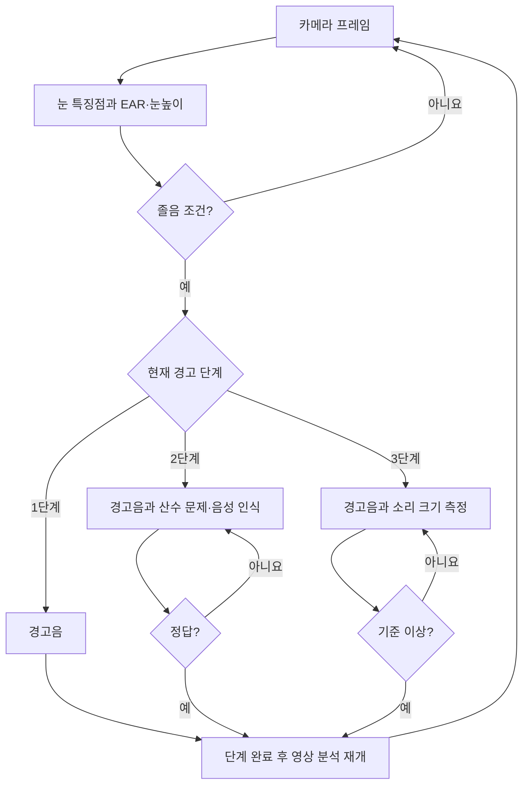

# 졸음운전 예방 카메라 — 최종 발표 기준 통합 코드

**현재 `main` 브랜치의 유일한 프로젝트 코드 버전입니다.** 2023년 최종 발표의 기능·분기와 확보된 2023년 원본 소스를 바탕으로, 최종 통합 프로그램의 미확보 부분을 연결하여 작성한 **2026년 복원본**입니다. **2023년 당시 최종 실행 원문과 동일하다는 뜻은 아닙니다.**


## 코드의 정체성과 실제 검증 범위

| 구분 | 확인된 내용 |
|---|---|
| **2023년 실제 프로젝트** | EAR 기반 눈 감지와 TTS/STT 및 음량 측정 기능을 개발·시험했고, 정지 중·주행 중·야간 시험 영상이 존재 |
| **실제 개인 역할** | 4인 팀 중 **음성팀 2인(노상운·한상원)**; 파일별 단독 작성자는 미확인 |
| **2023년 부분 원본** | [보관 브랜치의 실험 코드](https://github.com/hsw-dotcom/driver-drowsiness-detection/tree/archive/pre-final-cleanup/src) |
| **현재 main** | 2026년 신규로 작성한 **통합 복원 코드**. 2023년 최종 실행 원문은 아님 |
| **검증된 것** | 2023년 영상에 나타난 화면·장치 시험, 2026년 로직을 검증하는 오프라인 테스트 |
| **미검증** | 동일 소스로 실차 재실행, 정량 정확도, 3단계 전체 분기 완전 동작, 안전장치로서의 효과 |

[2023년 시험 영상의 확인 사실](docs/TEST_EVIDENCE_2023.md) · [원본과 복원 코드 대응표](docs/PROVENANCE.md)

**주의:** 주행 중 산수 문제나 큰 소리를 요구하는 설계는 운전자 주의를 분산시킬 수 있습니다. 실제 운전 안전장치로 사용하거나 사고 예방 성능이 검증된 제품으로 소개하지 않습니다.

## 파일 구성

- `main.py` — 유일한 통합 진입점, 카메라 감지 → 경고 → 응답 → 영상 재검사
- `drowsiness/vision.py` — 원본 `test.py`/`test_v2.py`의 68점 눈 랜드마크·EAR·눈높이 임계값 반영
- `drowsiness/camera.py` — Picamera2 카메라, 컬러 프레임 처리
- `drowsiness/stages.py` — 최종 발표의 1→2→3→1 경고 및 반복 분기
- `drowsiness/quiz.py` — 원본 `test1.py`/`222.py` 기반 산수 문제, 한국어 Google TTS/STT
- `drowsiness/loudness.py` — 당시 대화 기반 RMS 음량식(원본 `decibel.py`는 미확보)
- `drowsiness/audio.py` — 순차 경고음 재생 (WAV 원본 미포함)
- `drowsiness/config.py`, `config.ini` — 개발 대화 기준 설정
- `tests/` — 하드웨어 없이 검증하는 로직 테스트
- `docs/PROVENANCE.md` — 원본·발표·복원 경계와 실증하지 못한 내용

중복된 `test.py`, `test_v2.py`, `111.py`, `222.py`, `333.py` 등 **오래된 실험 코드는 현재 브랜치에서 제거**했습니다. 기존 코드는 [보존 브랜치](https://github.com/hsw-dotcom/driver-drowsiness-detection/tree/archive/pre-final-cleanup/src) 또는 Git 이력에서 열람할 수 있습니다. 새 코드는 원본을 복사해 여러 위치에 중복 저장하지 않습니다.

## 발표 자료 기준 기능

1. 눈의 종횡비(EAR)와 눈높이로 졸음을 판단합니다. dlib 얼굴 검출은 눈 랜드마크 위치 탐색용으로만 쓰며 **얼굴형으로 졸음을 분류하지 않습니다**.
2. 초기 EAR·눈높이 측정 후, 평균 EAR×0.8 이하 상태가 10프레임 계속되거나 눈높이가 평균+20픽셀을 넘으면 위험 조건입니다.
3. 감지 1회: 경고음; 2회: 경고음 + **같은 산수 문제의 정답을 맞힐 때까지 반복**; 3회: 경고음 + **음량 기준을 넘을 때까지 반복**; 다음 감지는 **1회차로 복귀**합니다.
4. 사용자가 확인한 음성 응답 인식 구간은 약 **10초**입니다. 당시 실험에서 안경·선글라스 착용 상태에서도 동작했습니다(보편적 검출률을 보장하지 않음).
5. 경고/응답 도중 프레임 분석은 추가로 실행하지 않으며, 단계가 끝난 뒤 다시 검사합니다. 경고 후 1초 재감지를 무시합니다.

`config.ini`의 초기 측정 3초와 경고음 파일 순서 등 후기 대화 설정을 우선했습니다. 확보된 `test_v2.py` 초기 실험은 30초 측정이었으므로 **버전 차이**가 있습니다. 자세한 근거는 `docs/PROVENANCE.md`에 기록했습니다.


## 통합 복원본의 처리 흐름 (2026년 코드, 하드웨어 미검증)



그림은 당시 최종 발표와 대화를 바탕으로 **2026년에 복원한 제어 흐름**이며, 모든 경로가 2023년 실차에서 성공했다는 증거는 아닙니다.

## 하드웨어 없이 코드 점검

```bash
python3 -m unittest discover -s tests -v
python3 main.py --demo
```

`--demo`는 입력값·정답·음량 반응을 모의 생성합니다. 테스트 개수는 수시로 변경되므로 수치보다 실제 실행 결과를 확인하세요. **실제 카메라, 음성 녹음, TTS/STT 네트워크, 하드웨어 경고음을 테스트하지 않습니다.** 따라서 제품 안전성이나 실제 차량 동작을 증명하지 않습니다.

## 의존성에 대한 기록

실장에 필요한 Picamera2, OpenCV, dlib predictor 데이터, 마이크/스피커, 원본 WAV, Google Cloud 인증은 별도로 필요하며 저장소에 포함하지 않았습니다. 이 저장소는 **하드웨어 없는 코드 복원**을 목적으로 합니다. 실제 통합 실행은 검증하지 않았습니다.

## 자동 오프라인 검증

[GitHub Actions — Offline reconstructed logic tests](https://github.com/hsw-dotcom/driver-drowsiness-detection/actions/workflows/offline-checks.yml)는 Python 단위 테스트 및 모의 3단계 실행을 자동화합니다. **2023년 실차 시스템의 동작 결과나 실제 안전성·성능 검증과는 별개**입니다.
